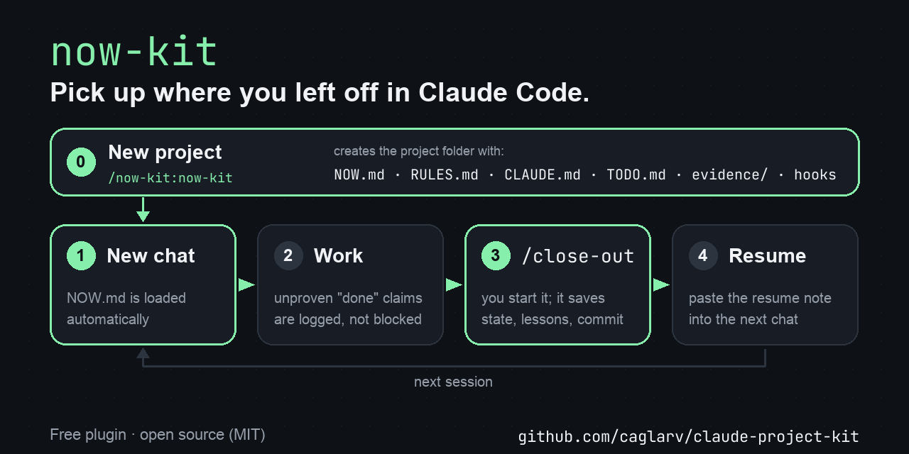

# Claude project kit



Long projects with Claude Code tend to lose the thread: every new chat starts with "where were we?", Claude says "done" without checking,
and what was decided last week is forgotten. This kit gives each project a small, fixed structure that Claude reads and keeps up to date on its own.

In plain terms, it gives every project:

- **A "what now?" page (NOW.md)** that Claude sees at the start of every chat, so it picks up exactly where you left off.
- **Standing rules (RULES.md)**: show proof before saying "done", label unmeasured numbers, ask before anything that costs money or goes outside.
- **A close-out routine (/close-out)**: at the end of a session Claude saves the state, writes down lessons, commits, and leaves a note for the next chat.
- **Safety nets**: if a chat ends without a close-out, or the conversation is compacted, the current state is written to disk first.

**Built for Claude Code, and that is where it works best.** Any Claude model works (Opus, Sonnet, Haiku), because everything
automatic here is a Claude Code hook. Other AI agents can still use the files by hand; see [Without Claude Code](#without-claude-code).

## Install

In Claude Code:

```
/plugin marketplace add caglarv/claude-project-kit
/plugin install now-kit@claude-project-kit
```

The `/plugin` commands work in the terminal version of Claude Code (`claude`). Where they aren't available (for example in the desktop app), copy the skill by hand instead; the skill is then called `/now-kit` rather than `/now-kit:now-kit`, and it shows up in chats started after the copy. Use one install method, not both.

Or copy the skill by hand:

```bash
git clone https://github.com/caglarv/claude-project-kit.git
mkdir -p ~/.claude/skills
cp -R claude-project-kit/skills/now-kit ~/.claude/skills/
```

## Use

Tell Claude Code **"set up a new project"**, or call the skill by name: `/now-kit:now-kit` (plugin install) or `/now-kit` (copied by hand).
It asks for a folder, a name, a one-sentence purpose and a short prefix (e.g. `BL`), then installs everything.
If you copied the skill by hand (second install option), you can also run the script yourself:

```bash
python3 ~/.claude/skills/now-kit/scripts/setup.py ~/projects/blog --name "Blog" --purpose "track weekly posts" --prefix BL
```

Sample output:

```
written 17 files · skipped (already existed, untouched) 0
git: initialised (no commit)
VERIFICATION OK · now_check OK 19 · hooks registered · .gitignore ok · scripts compile
```

Then open a new Claude Code chat in that folder; NOW.md should appear at the start.
To end a session, say **"start the close-out"** or type `/close-out`.

Other options: `--no-git` skips `git init`; if git isn't installed at all, an existing `.gitignore` can't be checked and the result line says `.gitignore not verified`; `--compare` (read-only) shows which hooks in an existing project differ from the template.
The script never overwrites a file that already exists. If your project already has `.claude/settings.json` or `.gitignore`, it checks them and tells you what to add instead.

## What it installs in your project

```
<project>/
├── CLAUDE.md          short instructions loaded every session
├── NOW.md             "what now?" page, ≤40 lines, 8 fixed sections
├── RULES.md           standing rules, searched when needed
├── TODO.md            deferred work and ideas
├── evidence/          decision & evidence index; old NOW.md copies
├── data/              raw/personal data, kept out of git
├── .gitignore
└── .claude/
    ├── settings.json  registers the hooks below
    ├── hooks/         8 hook scripts + state_io.py and py.sh, shared helpers (see below)
    └── skills/close-out/SKILL.md
```

The hooks, and when they run:

- **On chat start, resume, `/clear` and after compaction** (`now_load.sh`, `now_check.py`, `due_dates.py`): checks NOW.md, shows it to Claude, highlights scheduled tasks that are due, and shows (once) a note left by a chat that ended without a close-out.
- **Before compaction** (`precompact_snapshot.sh`): saves git state, recently changed files and the next step.
- **After every answer** (`claim_check.py`, `close_reminder.py`): logs English "done / fixed / tests passed" sentences that no successful command backs up (it sees that a command ran without error, not what it proved — treat the log as "worth a look"; it only writes a log and never stops Claude), and reminds you to close out once the chat passes ≈300k and ≈600k tokens.
- **On chat end** (`safety_net.py`): if no close-out happened, writes git state, your last messages and the next step to `.claude/state/`.
- **During close-out** (`close.py`): archives NOW.md and writes `resume_prompt.md`.
- **Shared helper** (`state_io.py`): every hook writes to `.claude/state/` through it; it refuses symlinks that lead outside the project and never overwrites an earlier note.

The plugin adds the `now-kit` skill at the scope you choose when installing it. The hooks are copied into each project when you set it up and only run inside that project. These hook scripts make no network requests of their own.

`resume_prompt.md` is a local hand-off file written at the end of each close-out, after the commit, so it isn't committed and a fresh clone won't have it. NOW.md's header shows the commit the session started from; the close-out commit itself is in `resume_prompt.md`.

## Settings

Optional, in the project's `.claude/settings.json` under an `"env"` block:

- `CLOSE_REMIND_TOKENS`: chat size at which the close-out reminder appears (default `300000`).

## Uninstall

- The skill: `/plugin uninstall now-kit@claude-project-kit` (or delete `~/.claude/skills/now-kit` if you copied it by hand).
- From a project, remove only what this kit added:
  1. In `.claude/hooks/` delete these ten files: `now_load.sh`, `now_check.py`, `due_dates.py`, `precompact_snapshot.sh`, `claim_check.py`, `close_reminder.py`, `safety_net.py`, `close.py`, `state_io.py`, `py.sh`. Delete the `.claude/hooks/` folder only if it is empty afterwards (other tools may keep their own hooks there).
  2. Delete `.claude/skills/close-out/`.
  3. In `.claude/settings.json` remove only the hook entries whose command points to one of the files above — keep any hooks other tools added.
  4. `.claude/state/` holds only this kit's logs and notes; delete it if you like.
  Your NOW.md, RULES.md and other notes stay; delete them too if you don't want them.

## Without Claude Code

The kit is designed for Claude Code and gives the best results there. Everything automatic depends on Claude Code hooks, so in other AI agents
(any model) none of it runs on its own: NOW.md isn't loaded at the start, claims aren't checked, no safety note is left when a chat ends,
no snapshot is taken before compaction, and there's no close-out reminder.

The files still help, if you do by hand what the hooks would do:

1. **Set up** with the script (needs `python3`): clone this repo, then run
   `python3 claude-project-kit/skills/now-kit/scripts/setup.py <folder> --name "<name>" --purpose "<sentence>" --prefix XX`.
2. **Start every chat** by pasting `resume_prompt.md`. Before the first close-out that file doesn't exist yet, so paste this instead:
   ```
   Read NOW.md and do only its "Next ONE step". Before you claim anything is done or passed, follow the RULES.md §2 table
   and show the command output. Answer in ≤12 lines, result first. Summarise NOW.md for me and wait for my approval.
   ```
3. **End every session** by asking the agent to follow `.claude/skills/close-out/SKILL.md` step by step. It runs
   `python3 .claude/hooks/close.py archive`, rewrites NOW.md, checks it with `python3 .claude/hooks/now_check.py NOW.md`,
   and runs `python3 .claude/hooks/close.py finish`, which writes the next `resume_prompt.md`.
   If the agent can't run commands, run these three yourself. Outside Claude Code `finish` prints
   "session not marked as closed"; that is expected and harmless.

The agent doesn't have to be a Claude model, but the instructions were written and tested with Claude in Claude Code. Results with other agents may vary and have not been tested.

## Requirements

- [Claude Code](https://claude.com/claude-code) (recommended; see [Without Claude Code](#without-claude-code) otherwise)
- Python 3.9 or newer (`python3 --version`; on Windows `py -3 --version`). The hooks run Python through `py.sh`, which tries `python3`, then `py -3`, then `python`.
- git (optional, needed for the close-out commit)
- macOS or Linux (the hooks use `sh`). Tested on macOS with Python 3.9.6, including a live Claude Code session (setup, session start, close-out). Linux is intended to work but has not been tested. The pre-compaction and session-end hooks have only been tested with simulated input so far.
- Windows: not officially supported. One user tried it with Git Bash (which provides `sh`) and Python 3.12 in the Claude desktop app: setup passed and the session-start hook loaded NOW.md, after turning off the Microsoft Store `python.exe` / `python3.exe` entries under Settings → Apps → Advanced app settings → App execution aliases. The `py -3` fallback in `py.sh` was added after that test and has not been tried on Windows yet.

## License

MIT — see [LICENSE](LICENSE).
